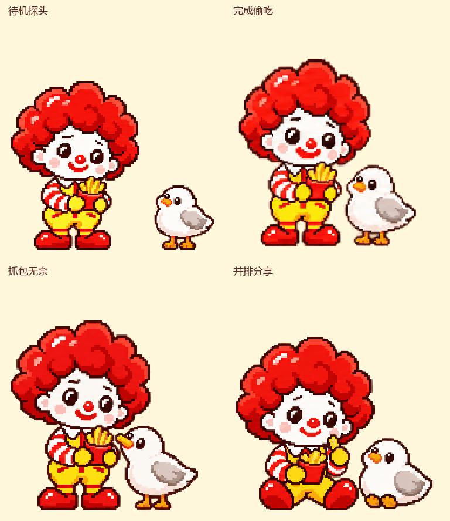

# 麦麦 · 像素餐单助手

红卷发的麦麦，和一只总惦记薯条的海鸥。面向想按预算挑选麦当劳餐单、又喜欢像素陪伴角色的用户。


面向想按预算挑选麦当劳套餐、又喜欢像素桌宠的用户。项目由 **Codex 自定义宠物包 + Agent Skill + 麦当劳 MCP** 组成，需要宿主提供模型、会话、工具和宠物渲染。它不是独立桌面程序。

本次参赛 MVP 包含两部分：**可由 AI 宿主使用的餐单 Skill 和只读 MCP 客户端**，已有真实查询、核价与换饮料验证；以及 **可直接打开的悬浮对话与 21 组角色动作原型**。网页回复为有限脚本，未接实时模型或 MCP 后端，历史报价与接口原图均单独标注。

## 快速体验网页原型

克隆或下载本仓库后，在项目根目录运行（Python 3.11+）：

```powershell
python -m http.server 8766 --bind 127.0.0.1
```

浏览器打开 `http://127.0.0.1:8766/`，点击右下角麦麦。可按“30元配餐 → 北京站附近 → 确认测试门店 → 选第二份 → 饮料换大杯 → 看看确认单”体验完整演示；或长按麦麦、说“摸摸你”“一起吃薯条”。动作画廊位于 `docs/motion-preview.html`。网页演示无需填写 Token。

> 非麦当劳官方产品。第一版支持到店自取的菜单查询、候选整单核价、替换后重新核价与确认单；不会创建订单、领券、兑换积分或付款。

## 当前进度

- 已完成业务 Skill、只读 MCP 客户端、核心工具 schema 快照与单元测试。
- 已实际查询测试门店、菜单、三份套餐详情、三次整单核价及换饮料重新核价。见 [验证记录](docs/verification.md)。
- 已根据六张用户参考图完成可爱像素主形象、九种状态共 57 帧与正式宠物包，图集与独立视觉检查通过。
- 新增海鸥搞薯条四段小剧场：待机探头、完成偷吃、抓包无奈、并排分享，共 20 帧。透明素材与独立视觉检查通过；[打开交互预览](docs/seagull-preview.html)，或[看四段动图](docs/media/seagull/preview.gif)。
- 新增倾听、说话、翻找信息、算价格、炸薯条、吃薯条、打瞌睡、摸头回应八组动作，共 32 帧。已接入悬浮对话演示；[查看全部 21 组动作](docs/motion-preview.html)，见[设计与参考来源](docs/motion-design.md)和[最终提示词](docs/motion-generation-prompts.md)。
- 本机宠物和 Skill 已安装；应用内实际选择、显示及从宠物入口发起完整对话仍待宿主界面验收。

## 使用

在支持自定义宠物和 Agent Skill 的 Codex 桌面宿主中使用。Windows 安装：

```powershell
powershell -ExecutionPolicy Bypass -File scripts/install.ps1
```

这次调用仅允许此项目的安装脚本运行，不更改系统执行策略。脚本将 `skills/maimai-butler` 和 `pet` 包安装到本机 Codex 目录，已有同名包会先备份。重新开启会话发现 Skill，在宿主的宠物列表中选择“麦麦”。可加 `-SkillOnly` 只安装业务 Skill，或用 `-DestinationRoot` 指定独立安装位置。

麦当劳 MCP 需要自己的 Token，从[麦当劳 MCP 平台](https://open.mcd.cn/mcp)申请。把凭证设置为本机环境变量 `MCD_MCP_TOKEN`，不要放进项目。已有宿主进程可能需要重启才能读取新增环境变量。

Codex 的 `config.toml` 配置示例：

```toml
[mcp_servers.mcd-mcp]
url = "https://mcp.mcd.cn"
bearer_token_env_var = "MCD_MCP_TOKEN"
```

其他宿主可参考 [mcp-config.example.json](mcp-config.example.json)，其中变量占位符需要宿主支持环境变量替换；不能把示例占位符当成真实凭证。

新会话输入：

```text
请用 $maimai-butler 帮我挑一份一人 30 元以内的麦当劳餐单。
到店自取，想吃汉堡，不要含糖饮料。先问我城市和门店，再查真实报价。
```

确认具体门店后，麦麦比较最多三份餐单。你可以继续说“第二份换大杯无糖可乐”，它会重新核价；说“就这个”，它输出确认单，停在尚未下单的状态。

## 独立验证 MCP

项目客户端仅使用 Python 3.11+ 标准库，不需要安装 Python 包：

```powershell
python scripts/mcd_readonly.py probe
python scripts/mcd_readonly.py schema
'{"beType":1,"searchType":2,"city":"北京市","keyword":"北京站"}' | python scripts/mcd_readonly.py call query-nearby-stores
python -m unittest discover -s tests -v
```

`call` 默认从标准输入读取 JSON，也支持 `--args-file`。工具名白名单限制为查询和核价，拒绝订单、领券和积分写操作。响应可能包含账户信息，公开演示时只保存必要的脱敏字段。

## 示例结果

下表是 **2026-10-24 22:38（UTC+8）的历史真实核价**，测试门店为北京崇外新世界餐厅，到店自取，饮料均选择中杯无糖可口可乐。它不是当前价格或你的附近门店。

| 本轮候选 | 整单应付 | 30 元预算余量 |
| --- | ---: | ---: |
| 龙焰鸡腿堡三件套 | ¥26.90 | ¥3.10 |
| 吉士汉堡包中套餐 | ¥26.50 | ¥3.50 |
| 麦香鸡中套餐 | ¥28.00 | ¥2.00 |

第二份饮料换为大杯无糖可口可乐，完整整单重新核价为 **¥28.50**，余量 **¥1.50**。仅比较本轮候选，不承诺全菜单最低价。本轮未查询或使用账户优惠券，未创建订单。

## 海鸥搞薯条

海鸥偷偷顺薯条，麦麦每次都发现，却拿它没办法。待机时偷偷靠近；麦麦庆祝时叼走一根；被抓包就装无辜；休息时麦麦也会主动分它吃。



双击打开 `docs/seagull-preview.html` 即可切换四段，演示任务完成、暂停、实际尺寸和减少动态效果。选中“偶尔自动探头”，普通待机 45–60 秒后播放一次彩蛋。扩展动画打包在 `pet/extras/seagull/`，安装脚本会一并复制。Codex 原生仍使用九状态图集；扩展的真实任务事件尚未接入，页面上的任务完成按钮为演示。见 [设计与接入说明](docs/seagull-design.md)和[最终提示词](docs/seagull-generation-prompts.md)。

## 点餐页面中的悬浮麦麦

用户已进一步明确：核心是和人物沟通。麦麦悬浮在未来点餐页面上，点击人物就在身旁展开对话，收起保留记录。配餐、优惠、门店菜单均通过对话完成；回复采用简短文字和圆形商品卡片，选择后可继续聊着修改。此前以点餐功能页为中心的布局已替换为[悬浮对话原型](docs/mobile-ordering-preview.html)，见[交互设计稿](docs/mobile-ordering-ux.md)。

原型包含追问门店、预算餐单卡、圆图单品展示、连续修改饮料、历史核价、停止与重试、旧餐单失效标记、对话内确认单与人物动作。当前回复仍为有限脚本，价格是明确标记的历史结果，商品图已换为实际取得的 MCP 原图（缺图明确标注），优惠未实时查询。尚未连接真正的 AI 或实时 MCP，也不是官方小程序。原有 Skill 和只读客户端可作为后续真实业务接入基础；官方嵌入与真实订单动作需要单独实现。

人物会随交流切换动作：输入时侧耳听，准备查询时翻册子，核价时按计算器，回复时配合口型。长按人物约 550ms，或发消息“摸摸你”“休息一下”“吃根薯条”“一起吃薯条”“表演炸薯条”，可以看到对应互动。人物忙碌时以任务为先，停止和失败会取消排队中的庆祝。餐单数量和金额不受陪伴小动作影响。

## 项目文件

- [Skill](skills/maimai-butler/SKILL.md)：宿主内的业务流程与行为边界。
- [接入说明](MCP_INTEGRATION.md)：服务、工具、实际流程及限制。
- [只读客户端](scripts/mcd_readonly.py)：运行时发现工具并执行只读请求。
- [历史验证快照](docs/live-verification.snapshot.json)：请求、实际选择、金额和时间，不含凭证。
- `pet/`：主形象及最终宠物包；`docs/media/`：预览素材。
- [九状态联系表](docs/media/contact-sheet.png)与[美术验收报告](docs/pet-qa.json)：57 个有效帧、15 个透明空格。
- [生成提示词](docs/generation-prompts.md)：本次美术方向与各动作提示词。
- [海鸥扩展验收](docs/seagull-qa.json)：20 帧、12 个透明空格与四段视觉检查。
- [陪伴动作验收](docs/motion-qa.json)：新增 32 帧、独立逐帧检查与 19 项逻辑测试；浏览器交互和实时播放仍待验收。

参赛声明采用官方原文，见 [CONTEST_DECLARATION.md](CONTEST_DECLARATION.md)。比赛要求见[官方活动规则](https://github.com/M-China/mcd-developer-innovation-challenge/blob/main/activityGuidelines.md)。本项目以普通参赛项目提交，不包含 WorkBuddy 使用记录，不声称符合 WorkBuddy 专项条件。

## 素材与来源

业务代码和 Skill 在本项目中编写，未复制其他参赛项目代码。宠物由用户提供的六张角色参考图引导 AI 生成；原始参考图仅作为本机制作输入，不随公开项目分发。麦当劳相关角色与标识权利属于其权利人，本项目不声称取得官方授权。生成使用本机已配置的图像中转和官方 imagegen 脚本；图集采用已安装 hatch-pet 工具链处理。

本仓库原创代码按 [MIT](LICENSE) 开源。该许可不授予麦当劳商标、既有角色、第三方商品照片或其他第三方素材的权利。商品照片由 MCP 返回的官方地址加载；动作设计参考的 mcpet 原项目及范围见 [来源说明](docs/motion-design.md)。已交付的图集和 GIF 可直接用于本项目演示；重新生成所需的本机中间素材和图像服务凭证不随仓库发布。

## 对话逻辑与商品原图（2026-10-25）

已按用户要求细化 [对话、动作与产出规则](docs/conversation-design.md)，接入按任务切换动作、消息逐条展示、核价成功才庆祝。两份套餐与五个单品 / 规格共七张原图实际来自 MCP，见 [图片来源快照](docs/product-images.snapshot.json)；圆形展示，缺图不借用其他商品照。龙焰历史商品当前未匹配到，已标明。图片更新不代表重新核价；页面价格仍为历史记录。25 项相关逻辑测试通过，浏览器实际加载与交互仍待验收。
